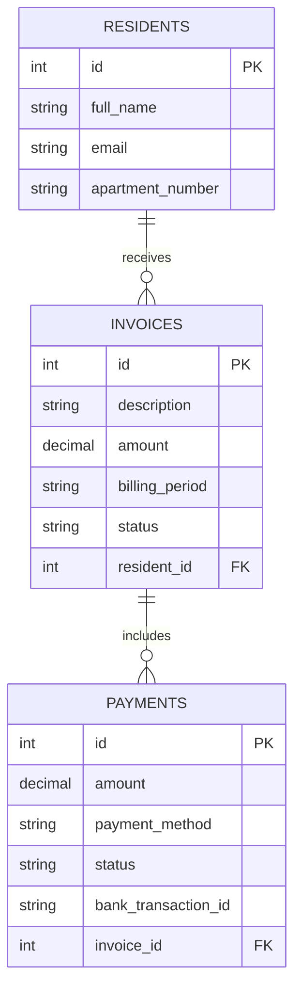

# Payments ORM

## Используемые технологии

- **Python 3.9** - язык программирования.
- **SQLAlchemy 2.0** - ORM для взаимодействия с базой данных.
- **Alembic** - инструмент управления миграциями базы данных.
- **SQLite** - реляционная база данных.

## Описание моделей данных

В проекте реализованы три основные ORM-модели.

### 1. Resident - жилец

Модель предназначена для хранения информации о жильцах управляющей организации.

Поля:
- `id` - уникальный идентификатор жильца.
- `full_name` - ФИО жильца.
- `email` - адрес электронной почты.
- `apartment_number` - номер квартиры.

### 2. Invoice - начисление

Модель предназначена для хранения информации о начислениях за коммунальные услуги.

Поля:
- `id` - уникальный идентификатор начисления.
- `description` - описание начисления.
- `amount` - сумма начисления.
- `billing_period` - расчётный период.
- `status` - статус начисления.
- `resident_id` - идентификатор жильца, которому выставлено начисление.

### 3. Payment - платёж

Модель предназначена для хранения информации об оплатах коммунальных услуг.

Поля:
- `id` - уникальный идентификатор платежа.
- `amount` - сумма платежа.
- `payment_method` - способ оплаты.
- `status` - статус платежа.
- `bank_transaction_id` - идентификатор банковской транзакции.
- `invoice_id` - идентификатор начисления, за которое осуществляется оплата.

## Схема базы данных

Для представления структуры базы данных используется диаграмма сущность-связь (ER-диаграмма).

Связи между сущностями:
- Один жилец может иметь несколько начислений.
- Каждое начисление связано с одним жильцом.
- Одно начисление может иметь несколько платежей.
- Каждый платёж относится к одному начислению.

## Реализация паттерна Repository

Для организации доступа к данным реализован класс `PaymentRepository`.

Репозиторий обеспечивает выполнение операций над платежами и отделяет логику работы с базой данных от остальной части приложения.

Реализованные методы:
- `create()` — создание нового платежа.
- `get_by_id()` — получение платежа по идентификатору.
- `get_all()` — получение списка всех платежей.
- `update_status()` — изменение статуса платежа.
- `delete()` — удаление платежа.
- `get_by_status()` — получение платежей по определённому статусу.
